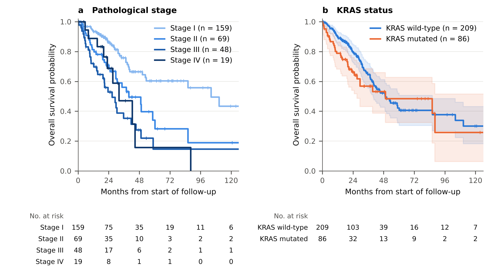
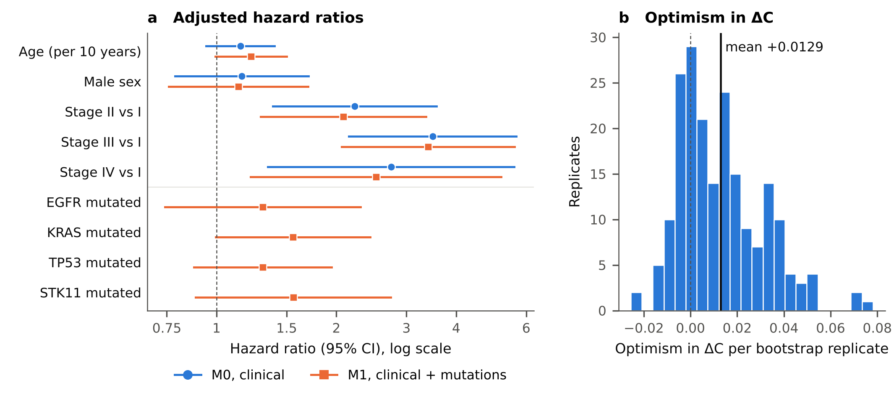
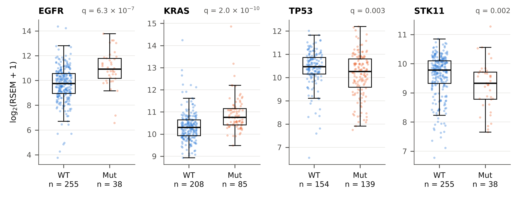

# OncoLung AI

**Do driver mutations add prognostic information beyond stage in lung adenocarcinoma?**
A clinical–genomic survival analysis of TCGA-LUAD with matched RNA expression.

Cristian Daniel Medina Gomez, Bocconi University (BSc CLEAM). Submission to the GeNeDis 2026 Satellite Hackathon, NSCLC.

The full write-up is in [`OncoLung_AI_Scientific_Report.pdf`](OncoLung_AI_Scientific_Report.pdf).

## Summary

I compare two Cox models for overall survival in 295 TCGA-LUAD patients (109 deaths):

- **M0**: age, sex, pathological stage
- **M1**: M0 + mutation status of EGFR, KRAS, TP53 and STK11

| | M0 | M1 | M1 − M0 |
|---|---:|---:|---:|
| Apparent C-index | 0.668 | 0.688 | +0.019 |
| Mean bootstrap optimism | 0.015 | 0.028 | +0.013 |
| Optimism-corrected C-index | 0.654 | 0.660 | +0.006 |

The four mutations do not significantly improve the model (likelihood-ratio test 7.23 on 4 d.f., p = 0.12), and most of the apparent gain in discrimination disappears after bootstrap correction. Stage is the dominant predictor.

In 293 patients with matched RNA-seq, each gene's expression differs by its own mutation status: higher in EGFR- and KRAS-mutated tumours, lower in TP53- and STK11-mutated tumours (all BH-adjusted p < 0.01).





## Data

cBioPortal, **TCGA-LUAD PanCancer Atlas** (`luad_tcga_pan_can_atlas_2018`). Three layers are used: clinical data, somatic mutations (whole-exome) and RNA-seq (batch-normalised RSEM).

Cohort selection: 566 patients → 489 with complete age, sex, stage and positive overall survival → 295 with sample acquisition recorded at day zero. 293 of them have RNA-seq.

Details on files, variant definition and how to download the full expression matrix are in [`docs/SOURCES_AND_REPRODUCTION.md`](docs/SOURCES_AND_REPRODUCTION.md).

## How to run

Everything runs from the files in this folder; no large download is needed.

```bash
# survival models, bootstrap and report figures (Python 3.13)
pip install -r requirements.txt
python scripts/make_report_figures.py

# rebuild the cohort table from the cBioPortal files, then the expression analysis (Python 3.12)
pip install -r requirements-rna.txt
python scripts/reconstruct_cohort.py
python scripts/rna_extension.py
```

The notebook `OncoLung_AI_Clinical_Genomic_v1.ipynb` contains the survival analysis step by step with saved outputs. To rerun it, open it in Colab and upload `tcga_luad_day0.csv`.

## Contents

| Path | What it is |
|---|---|
| `OncoLung_AI_Scientific_Report.pdf` | Report: methods, results, limitations |
| `OncoLung_AI_Clinical_Genomic_v1.ipynb`, `OncoLung_AI.py` | Survival analysis (notebook and script version) |
| `tcga_luad_day0.csv` | Analysis table, one row per patient |
| `oncolung_run_audit.json` | Environment and the 200 bootstrap records from the notebook run |
| `scripts/reconstruct_cohort.py` | Builds the analysis table from the source files |
| `scripts/rna_extension.py` | Mutation–expression analysis |
| `scripts/make_report_figures.py` | Refits the models and produces the figures and numbers in the report |
| `data/reference_inputs/` | cBioPortal clinical, sample and timeline tables; mutation rows for the four genes |
| `data/processed/` | Patient–sample map and expression of the four genes |
| `outputs/` | Figures, result tables and QC files |
| `docs/` | Data sources, expression analysis notes, input file hashes |

## Limitations

- The day-zero filter removes 40% of eligible patients; the analysis has not yet been repeated on all 489.
- Validation is internal (bootstrap). There is no external cohort.
- The proportional-hazards assumption is doubtful for KRAS; no time-varying model was fitted.
- Treatment is not modelled.
- The expression comparisons are not adjusted for tumour purity or copy number.

This is a research exercise on public data, not a clinical tool.

## Acknowledgements

The results are based upon data generated by the [TCGA Research Network](https://www.cancer.gov/tcga), accessed through cBioPortal.
