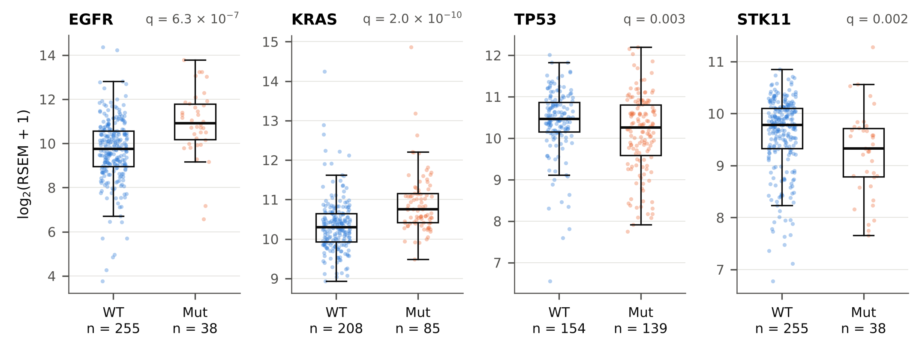

# Mutation–expression analysis

Supplementary notes to section 3.5 of the report.

## Question

Is the mutation status of EGFR, KRAS, TP53 and STK11 associated with the expression of the same gene? The four genes are the ones used in the survival models; no other genes were tested.

## Data and matching

- Expression: `data_mrna_seq_v2_rsem.txt` from the cBioPortal study (batch-normalised RSEM, Illumina HiSeq RNASeqV2), 20,531 genes × 510 samples. The matrix has no missing or negative values.
- Each of the four genes maps to exactly one row by symbol and Entrez ID (EGFR 1956, KRAS 3845, TP53 7157, STK11 6794).
- Samples are matched on the full sample ID, one primary tumour per patient. 293 of the 295 patients have RNA-seq (108 deaths). The two without are TCGA-44-6144 and TCGA-MP-A4T2.

## Method

Expression is transformed as log2(RSEM + 1). Mutated and non-mutated tumours are compared with a two-sided Mann–Whitney U test. The four p-values are adjusted with Benjamini–Hochberg. Effect sizes: difference in medians and rank-biserial correlation (positive = higher in mutated tumours).

## Results

| Gene | n, non-mutated / mutated | Median (IQR), non-mutated | Median (IQR), mutated | Difference | Rank-biserial | Adjusted p |
|---|---:|---:|---:|---:|---:|---:|
| EGFR | 255 / 38 | 9.75 (8.95–10.56) | 10.93 (10.18–11.78) | +1.17 | +0.51 | 6.3 × 10⁻⁷ |
| KRAS | 208 / 85 | 10.29 (9.93–10.65) | 10.75 (10.41–11.15) | +0.45 | +0.49 | 2.0 × 10⁻¹⁰ |
| TP53 | 154 / 139 | 10.47 (10.16–10.87) | 10.25 (9.59–10.81) | −0.21 | −0.20 | 0.003 |
| STK11 | 255 / 38 | 9.78 (9.32–10.10) | 9.33 (8.78–9.71) | −0.45 | −0.33 | 0.002 |

Full statistics: `outputs/rna/mutation_expression_results.csv`.

## Notes

- The comparisons are unadjusted. Tumour purity, copy number and variant class are not accounted for.
- The groups overlap substantially, especially for TP53.
- Expression was not added to the survival models.

## Files

| File | Content |
|---|---|
| `outputs/rna/clinical_mutation_rna_293.csv` | Matched table: clinical data, mutations and expression |
| `outputs/rna/rna_availability_295.csv` | RNA-seq availability per patient |
| `outputs/rna/full_matrix_qc.json` | Checks on the full expression matrix |
| `outputs/rna/rna_audit.json` | Inputs, hashes and software versions of the run |
